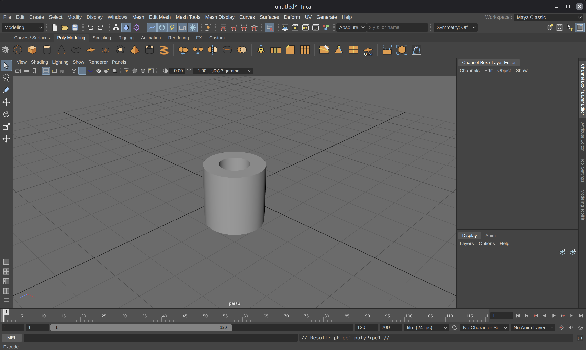

# Inca

A free, open-source 3D modeling, animation and rendering application for the desktop, with the
workflow and layout of Autodesk Maya. Inca is a native app written in Rust (egui + wgpu).

Website and downloads: **https://incacad.com**



See [FEATURES.md](FEATURES.md) for the full feature list.

## Contributing

Write an issue on the [GitHub issues page](https://github.com/v3ai/inca/issues). Pull requests are welcome;
[docs/ARCHITECTURE.md](docs/ARCHITECTURE.md) explains how the code is organised.

## Download and run

Go to the [Releases page](https://github.com/v3ai/inca/releases) and open the newest release. Under **Assets**, download the file for your computer.

### Windows
1. Download **`Inca-<version>-win-x64-portable.exe`**.
2. Double-click it. You don't need to install anything.
3. If Windows shows "Windows protected your PC", click **More info**, then **Run anyway**. Windows shows this for apps from small developers. It doesn't mean anything is wrong.

You can also download the **`.zip`** instead. Unzip it, then double-click **`Inca.exe`** inside the folder.

Inca needs a graphics card with DirectX 12, Vulkan or OpenGL support (any card from the last ten years).

### Linux
1. Download **`Inca-<version>-linux-x86_64.AppImage`**.
2. Right-click the file, open **Properties → Permissions**, and tick **Allow executing file as program**.
   In a terminal you can do the same with `chmod +x Inca-*.AppImage`.
3. Double-click it to start Inca.

If it doesn't open, start it from a terminal so you can see the error: `./Inca-*.AppImage`.
On Ubuntu 22.04 or newer, if you get an error about **FUSE**, run `sudo apt install libfuse2` once. On Ubuntu 24.04 the package is called `libfuse2t64`.
You can also download the **`.tar.gz`**, unpack it and run `./inca` inside the folder.

Inca needs a Vulkan or OpenGL driver (Mesa is fine) and the usual X11 / Wayland libraries.

### macOS
1. Download **`Inca-<version>-mac-arm64.dmg`** for Apple Silicon Macs (M1 and newer), or **`Inca-<version>-mac-x64.dmg`** for older Intel Macs.
   To check which you have, open the Apple menu → **About This Mac**: "Chip: Apple M…" means Apple Silicon.
2. Open the `.dmg` and drag **Inca** into **Applications**.
3. The first time, macOS says it can't check Inca for malware, because Inca isn't registered with Apple (that costs $99 a year).
   Click **Done**, then open **System Settings → Privacy & Security**, scroll down and click **Open Anyway** next to the message about Inca.
   On macOS 14 or older you can instead right-click Inca in Applications and choose **Open**.
   You only need to do this once.

## Run from source

1. Install Rust (current stable) from https://rustup.rs, or update it with `rustup update`.
2. In the `inca` folder:
   ```
   cargo run --release -p inca                 # start Inca
   cargo run --release -p inca -- scene.inca   # open a scene
   ```
   The first build takes a few minutes; later builds are quick.

Linux builds need no extra packages beyond a C toolchain (`build-essential`); running needs a
Vulkan or OpenGL driver and X11 / Wayland. Windows needs the MSVC build tools (rustup offers to
install them). macOS needs the Xcode command line tools (`xcode-select --install`).

## Tests
```
cargo test --workspace     # geometry kernel, construction history, MEL, file IO, booleans, path tracer, rigging, UI logic
```
Drive the real app from a MEL script and capture the window:
```
INCA_TEST=script.mel INCA_SHOT=out.png [INCA_SHOT_FRAME=12] cargo run -p inca
```
Lines starting with `//!ui <action>` in the script run UI actions, e.g. `//!ui layoutFour` or `//!ui renderCurrent`.

## Build release packages
```
cargo build --release -p inca
packaging/package.sh linux                          # dist/Inca-<ver>-linux-x86_64.AppImage and .tar.gz
packaging/package.sh windows                        # dist/Inca-<ver>-win-x64.zip and -portable.exe (run in Git Bash)
cargo build --release -p inca --target aarch64-apple-darwin
packaging/package.sh mac aarch64-apple-darwin       # dist/Inca-<ver>-mac-arm64.dmg (x86_64-apple-darwin for Intel)
```

## Releases
Bump `version` under `[workspace.package]` in `Cargo.toml` and push to `master`. The
[release workflow](.github/workflows/release.yml) tags `v<version>`, builds Windows, Linux and macOS
packages and publishes them on the [Releases page](https://github.com/v3ai/inca/releases). Pushing a
`v*` tag does the same. Every push and pull request also runs the [CI workflow](.github/workflows/ci.yml)
(tests and release builds on all three platforms).

## Layout
- `crates/inca-core` — engine without a GUI: scene graph and construction history, polygon kernel and
  modeling ops, primitives, curves, materials, animation, undo, MEL interpreter, file I/O, rigging,
  deformers, constraints, dynamics, booleans, the Inca Path Tracer
- `crates/inca` — the application: viewports, menus, shelves, panels, editors and tools
- `packaging/` — release packaging (AppImage, zip, dmg)
- `build/` — app icons

The `.inca` scene format is the same JSON format the earlier Electron versions (up to 0.1.12) used,
so old scenes open in this version.

MIT licensed. Built with egui, wgpu, glam, rapier3d, boolmesh, rhai and other Rust crates.
